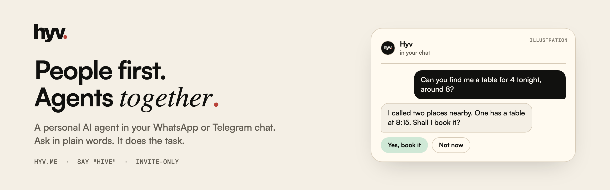

<a href="https://hyv.me">
  <picture>
    <source media="(prefers-color-scheme: dark)" srcset="https://raw.githubusercontent.com/hyvdotme/.github/main/profile/assets/banner-dark.png">
    
  </picture>
</a>

 

Hyv (say "hive") lives in the chat you already use. Ask in plain words and it does the task: it calls a business and reports back, drafts the email or the calendar invite, sets the reminder, builds the cart. It asks before anything that affects someone else or costs money.

Invite-only for now, at [hyv.me](https://hyv.me).

 

More from Hyv

 

**Guides:** [Schedule a WhatsApp message](https://hyv.me/notes/schedule-a-whatsapp-message) · [Send an email from WhatsApp](https://hyv.me/notes/send-email-from-whatsapp) · [Send a calendar invite from WhatsApp](https://hyv.me/notes/send-calendar-invite-from-whatsapp) · [Set reminders on WhatsApp](https://hyv.me/notes/set-reminders-on-whatsapp) · [Set a reminder in Telegram](https://hyv.me/notes/set-reminder-in-telegram) · [Personal AI assistants on WhatsApp](https://hyv.me/notes/personal-ai-assistants-on-whatsapp) · [An AI that calls businesses for you](https://hyv.me/notes/ai-that-calls-businesses-for-you)

**How it works:** [Email, calendar and reminders](https://hyv.me/notes/workspace-email-calendar-reminders) · [Message drafts you send](https://hyv.me/notes/message-drafts-you-press-send) · [Shopping](https://hyv.me/notes/shopping-buy-without-leaving-chat) · [Websites and your passwords](https://hyv.me/notes/browser-and-vault-passwords-stay)

**Hyv:** [About](https://hyv.me/about) · [Things to ask](https://hyv.me/ask) · [All notes](https://hyv.me/notes) · [How to spell Hyv](https://hyv.me/name) · [x.com/hyvdotme](https://x.com/hyvdotme) · contact@hyv.me

A product of Decimal - F.Z.C.

